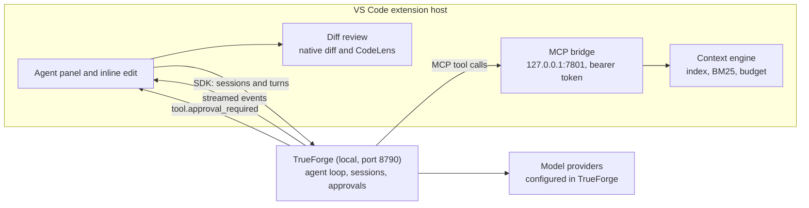

# Anvil

An editor-native coding agent for VS Code whose agent loop runs on [TrueForge](https://github.com/truefoundry/trueforge), TrueFoundry's open-source agent harness.

[](https://github.com/DikshitRJ/anvil/actions/workflows/ci.yml)
[](LICENSE)

TrueForge is the furnace: it runs the loop, streaming, sessions and approvals. Anvil decides what the model sees and how safely its changes land in your editor.

Anvil is an independent project built for the TrueFoundry Forge-a-thon. It is not an official TrueFoundry product.

## What it does

Anvil implements the five capabilities the brief requires:

1. **Inline edit.** Select code (or put the cursor inside a function), press `Ctrl+Alt+E` (`Cmd+Alt+E` on macOS), and describe the change. The replacement streams into a diff. You accept or reject each hunk.
2. **Agent mode.** One request in the Anvil panel drives the `anvil-coder` agent through a tool loop: search, read, edit several files, and run commands you approve. The agent finds the files itself.
3. **Context assembly.** `@file` and `@symbol` mentions are pinned. Anvil also retrieves code you did not mention, using BM25, symbol, path, open-editor and import-neighbour signals, packed into a token budget (12 000 tokens by default).
4. **Diff review.** Every write is previewed in VS Code's native diff editor and accepted or rejected hunk by hunk. Nothing reaches disk unreviewed, and applied changes can be undone.
5. **Streaming and cancellation.** Tokens render as TrueForge streams them. **Stop** or `Esc` aborts the run and kills running commands. By default the run's applied changes are reverted, so the workspace is left as it was.

Extras built on top:

- **Context Inspector.** A card per request lists every file or chunk sent, why it was chosen, its token cost and a budget bar.
- **Model Relay.** An ordered model chain (`anvil.models`). Transient failures retry with backoff. Fatal model failures switch to the next model inside the same TrueForge session.
- **Transactional runs and undo timeline.** Each run records the previous contents of every file it writes. The panel lists applied changes with **Undo change** and **Revert run** buttons.
- **No-silent-write invariant.** TrueForge pauses each write for approval. The MCP bridge then refuses any write that does not match a recorded decision.
- **Secure local bridge.** The MCP server binds to 127.0.0.1, requires a random bearer token, and confines every path to the workspace.
- **Doctor.** `Anvil: Run Doctor` checks TrueForge, the bridge, its registration, the agents, the configured models and the index.



Anvil never calls a model provider. Models are configured only in TrueForge, and the extension names them in `anvil.models`. The agent decides which editor tools to call, so the extension does not hard-code a workflow.

## Starting point: from scratch

Anvil does not fork another project. There is no upstream repository and no fork commit. The code in this repository was written from scratch and is released under the MIT License (see [LICENSE](LICENSE)).

We borrowed ideas, not code: the diff-review UX of Continue, the tool cards of Cline, and the search/replace edit format of Claude Code. The agent loop is TrueForge. The rationale is recorded in [docs/DECISIONS.md](docs/DECISIONS.md) (D-001).

## Requirements

- VS Code 1.95 or newer (`engines.vscode` is `^1.95.0`).
- Node.js 22.14 or newer to run TrueForge with `npx`. CI and local builds use Node 22 (see `.nvmrc`). `package.json` still lists `node >=20`, which is looser than what TrueForge needs.
- A model provider reachable from TrueForge: a paid API, a free tier, an AI gateway, or an OpenAI-compatible endpoint on your machine such as Ollama.

## Setup from a clean clone

These steps assume Git, Node 22 and VS Code are installed and nothing else.

1. Clone the repository and build it.

```bash
git clone https://github.com/DikshitRJ/anvil.git
cd anvil
npm ci
npm run build
```

2. Start TrueForge in local mode in a separate terminal, and leave it running.

```bash
HOST=localhost OUTBOUND_URL_ALLOWED_HOSTS='["127.0.0.1","localhost"]' npx @truefoundry/trueforge@latest
```

TrueForge serves its API and its chat UI at http://localhost:8790. Local mode uses SQLite and needs no login.

> **Why `HOST=localhost`?** zsh exports `HOST` (your machine's hostname) into the environment, and TrueForge reads `HOST` as its bind address. Without an explicit value it can bind to a name Anvil cannot reach. Setting `HOST=localhost` avoids that.

> **Why the allowlist?** TrueForge's network policy blocks loopback URLs by default (`Outbound URL blocked for host 127.0.0.1`). Anvil's MCP bridge listens on `127.0.0.1:7801`, and local model servers such as Ollama listen on `localhost`, so TrueForge must be allowed to reach them. The real-TrueForge e2e suite starts TrueForge exactly this way.

3. Configure a model in TrueForge. Either open the TrueForge UI (Settings, then Models) and add a provider there, or start from the example file and register it with the setup script:

```bash
cp config/trueforge.example.json config/trueforge.local.json
export GROQ_API_KEY=...   # set only the variables for the providers you use
npm run setup:trueforge
```

`config/trueforge.local.json` is gitignored. Its `${VAR}` placeholders are read from your environment. A provider whose variable is unset is skipped with a warning, so an Ollama-only setup needs no key. The setup script needs TrueForge to be running (step 2).

4. Install the extension. Either install a release build or build your own.

From a [GitHub Release](https://github.com/DikshitRJ/anvil/releases), download `anvil-v0.1.0.vsix` from the Releases page, then run:

```bash
code --install-extension anvil-v0.1.0.vsix
```

From source, package the extension and install the result:

```bash
npm run package          # writes anvil.vsix in the repository root
code --install-extension anvil.vsix
```

5. Set the model chain in your VS Code settings. Each entry is a `provider/model` reference, using names configured in TrueForge:

```json
{
  "anvil.trueforgeUrl": "http://localhost:8790",
  "anvil.models": ["groq/llama-3-3-70b", "ollama/qwen2-5-coder-14b"]
}
```

6. Open a folder in VS Code. Anvil starts its MCP bridge on 127.0.0.1:7801 and registers two things in TrueForge once it can reach TrueForge: the editor bridge (`anvil-editor`) and both agent definitions (`anvil-coder` and `anvil-inline`). This happens on activation and again whenever TrueForge becomes reachable. The bridge's bearer token is generated once and stored in VS Code SecretStorage.

7. Run **Anvil: Run Doctor** from the Command Palette. The report appears in the "Anvil Doctor" output channel. Fix any check marked with a cross; each failed check names its fix.

### Loading the agent definition

The two agent definitions live in `agent/`:

- `agent/anvil-coder.json` drives agent mode.
- `agent/anvil-inline.json` drives inline edit.

The extension registers both in TrueForge automatically (step 6). You can also register them with `npm run setup:trueforge`. Either way they appear by name in the TrueForge UI. Runs send their own inline copy of the spec, and the model in it is replaced at run time by the first usable entry in `anvil.models`. The `model.name` placeholder in the files is never used for a run.

Key fields in `anvil-coder.json`:

- `mcp_servers[0].require_approval_for_tools` lists `edit_file`, `write_file` and `run_command`. TrueForge pauses each of these calls and asks Anvil for a decision. Anvil opens the per-hunk review or the command prompt, and the answer returns to TrueForge as `user.tool_approval`.
- `mcp_servers[0].preload` is `false`, and `preload_tools` lists `search_code`, `read_file`, `edit_file` and `write_file`. The other editor tools are discovered on demand (deferred tool loading).
- `config.dynamic_sub_agents` is enabled. The coder may delegate broad reconnaissance to a subagent, which returns only a summary.
- `config.context_management.compaction` summarises older history at TrueForge's default trigger, 80% of the model's context length (a fixed trigger would never fire on small local models).
- `config.iteration_limit` is 60, which caps the number of iterations the agent loop may run in one turn.

Key fields in `anvil-inline.json`:

- `mcp_servers` is empty. Inline edit has no tools, so it cannot read or write anything on its own. Its only output is one fenced code block.
- `config.iteration_limit` is 2. Subagents, questions and generative UI are off.

### Example model configuration

`config/trueforge.example.json` is committed. The local copy with your settings is not. The example is:

```json
{
  "trueforgeUrl": "http://localhost:8790",
  "modelProviders": [
    {
      "type": "custom",
      "name": "groq",
      "base_url": "https://api.groq.com/openai/v1",
      "auth": { "api_key": "${GROQ_API_KEY}" },
      "models": [
        {
          "model_id": "llama-3.3-70b-versatile",
          "name": "llama-3-3-70b",
          "properties": { "context_length": 131072, "max_output_tokens": 8192 }
        }
      ]
    },
    {
      "type": "custom",
      "name": "ollama",
      "base_url": "http://localhost:11434/v1",
      "models": [
        { "model_id": "qwen2.5-coder:14b", "name": "qwen2-5-coder-14b", "properties": { "context_length": 32768 } }
      ]
    }
  ],
  "models": ["groq/llama-3-3-70b", "ollama/qwen2-5-coder-14b"]
}
```

How to read it:

- Each entry in `modelProviders` is a TrueForge provider. `type: "custom"` means an OpenAI-compatible endpoint. The `name` is the provider name used in references.
- A model reference is `<provider>/<model name>`. `groq/llama-3-3-70b` points at the Groq entry whose upstream `model_id` is `llama-3.3-70b-versatile`. Use the model's `name`, not its `model_id`.
- The first entry in `anvil.models` is the primary model. The next entries are fallbacks, tried in order when a failure is not worth retrying (see Model Relay in [docs/WRITEUP.md](docs/WRITEUP.md)).
- The top-level `models` array is a suggestion. The setup script prints it as a candidate `anvil.models` value and uses its first entry as the default model of the registered agents. Anvil reads its chain from the `anvil.models` setting.
- Keys are never written into the file. `${GROQ_API_KEY}` is expanded from your environment when the setup script runs. If you must store a literal key locally, put it in `config/trueforge.local.json`, which is gitignored. Do not put keys in any tracked file.

## Usage

### Inline edit

1. Select code. With no selection, Anvil targets the function or class around the cursor.
2. Press `Ctrl+Alt+E` (`Cmd+Alt+E` on macOS), or choose **Anvil: Inline Edit Selection** from the editor context menu.
3. Type the instruction. A diff opens against the file and updates as tokens arrive.
4. Review the hunks. A CodeLens above each hunk offers **Accept** and **Reject** (Anvil enables `diffEditor.codeLens` by default so the lenses show in the diff editor). The diff's title bar has check and cross buttons for the hunk at the cursor, plus **Accept all** and **Reject all**. While reviewing, `Alt+Y` accepts and `Alt+N` rejects the hunk at the cursor. Click a decided hunk's CodeLens to change that decision. Closing the diff tab rejects any undecided hunks.
5. The accepted hunks are written to the file and recorded in the timeline. Native undo also works for the open document.

### Agent mode

1. Open the **Anvil** view in the activity bar and type a request. Mention a file with `@path/to/file.py` (a unique path suffix also works). For paths containing spaces, use `@"docs/setup guide.md"`; autocomplete adds quoting when needed. Mention a symbol with `@SymbolName` or `@#SymbolName`.
2. Read the Context Inspector card. It lists the files Anvil put in front of the model and why.
3. Watch the run. Model text streams in, each tool call appears as a card, and each command request shows an approval card (also offered as a VS Code notification).
4. Each edit opens a review tab. Accept or reject its hunks as in inline edit. The agent receives the outcome as the tool result, including which hunks you rejected, and is told not to re-apply them.
5. The run ends with a summary. The changes timeline lists each applied change with **Undo change** and **Revert run**.

### Cancel

Press **Stop** in the panel, press `Esc` while a run is active, or run **Anvil: Cancel Running Task**. Cancel aborts the stream, asks TrueForge to cancel the turn, kills running commands and discards pending reviews. With the default `anvil.cancelBehavior` of `revert`, it also restores the files the run changed, and the panel reports how many were restored. Writes that arrive after cancel are refused.

### Undo

- The panel's timeline lists applied changes. **Undo change** reverts one change. **Revert run** reverts every change from one run, using the earliest saved contents for each file.
- **Anvil: Undo Last Applied Change** undoes the most recent change.
- If a file changed after Anvil wrote it, Anvil asks before restoring it: "File changed since — restore anyway?".

### Using a local model (Ollama)

Ollama defaults to a small context window (often 4096 tokens), and it silently drops the start of a longer prompt. Anvil warns when the model reports far fewer input tokens than Anvil sent. To fix it, give the model a bigger window with a Modelfile:

```
FROM qwen2.5-coder:14b
PARAMETER num_ctx 16384
```

Run `ollama create qwen2.5-coder-16k -f Modelfile` and point TrueForge at the new model, or set `OLLAMA_CONTEXT_LENGTH=16384` before starting Ollama. Keep `anvil.contextBudget` well below the window, because the system prompt, tool schemas and history share it. For a 4096-token window, use a budget of about 2000.

For slow local prefill or context compaction, start TrueForge with a longer model HTTP timeout. TrueForge 0.185.1 defaults to a 20-second response-header timeout, which can fail before a local model produces its first token:

```sh
HOST=localhost OUTBOUND_URL_ALLOWED_HOSTS='["127.0.0.1","localhost"]' \
MODEL_HTTP_HEADERS_TIMEOUT_MS=600000 MODEL_HTTP_BODY_TIMEOUT_MS=600000 \
npx @truefoundry/trueforge@latest
```

These settings belong to the TrueForge server process; increasing `anvil.stallTimeoutSec` alone does not change them. Use a bounded timeout appropriate to the machine, and keep the provider's declared context length consistent with the actual Ollama `num_ctx`.

> **Measured on this project:** Gemma 4 12B via Ollama (8 GB GPU) completes the inline edit (Task A) and the resilience task (Task C) end to end, and drives the full agent tool loop, but at 16k context it cannot finish the three-file agent change (Task B). Use a stronger hosted model (or a larger local one with ≥32k context) for agent-mode work.

### Switching models

Edit `anvil.models` in VS Code settings. The new chain applies to the next run. Anvil starts a fresh chat session when the chain changes while idle, so earlier history is not carried over.

### Open in TrueForge

Use the panel's **Open in TrueForge** button, or run **Anvil: Open Session in TrueForge**. Either opens the current chat's session in TrueForge's Sessions view at `<trueforgeUrl>/sessions/<id>`.

### Commands

- **Anvil: Inline Edit Selection** (`Ctrl+Alt+E`, `Cmd+Alt+E` on macOS)
- **Anvil: Cancel Running Task** (`Esc` while a run is active)
- **Anvil: New Chat**
- **Anvil: Set Up TrueForge Integration** (registers the bridge and agents)
- **Anvil: Run Doctor**
- **Anvil: Undo Last Applied Change**
- **Anvil: Open Session in TrueForge**
- **Anvil: Focus Panel**
- Hunk commands (accept or reject one hunk) are available from the CodeLens in the review tab. **Accept all** and **Reject all** are also in the review tab's title bar.

### Settings

All settings use the `anvil.` prefix. Numeric values are clamped to sane ranges in `src/core/config.ts`, for example `retriesPerModel` from 0 to 5 and `contextBudget` from 1 000 to 200 000.

| Setting                   | Default                 | Purpose                                               |
| ------------------------- | ----------------------- | ----------------------------------------------------- |
| `anvil.trueforgeUrl`      | `http://localhost:8790` | TrueForge base URL                                    |
| `anvil.models`            | `[]`                    | Ordered model chain, `provider/model`                 |
| `anvil.retriesPerModel`   | `1`                     | Transient retries on one model before switching       |
| `anvil.stallTimeoutSec`   | `120`                   | Seconds without an event before a stall is retried    |
| `anvil.contextBudget`     | `12000`                 | Token budget for the context pack in each request     |
| `anvil.mcpPort`           | `7801`                  | Port of the MCP bridge on 127.0.0.1                   |
| `anvil.cancelBehavior`    | `revert`                | `revert` undoes a cancelled run; `keep` keeps changes |
| `anvil.commandTimeoutSec` | `120`                   | Timeout for `run_command`                             |

`anvil.models` must be set. Doctor warns when it is empty.

### The three fixed demo tasks

The Forge-a-thon demo uses one repository for every team: pallets/flask at tag `3.1.3` (commit `22d92470`). Prepare it with:

```bash
scripts/demo/setup-flask.sh          # clones into $HOME/anvil-demo/flask, checks out 3.1.3, creates .venv, installs Flask (with dotenv) and pytest 9.0.2
scripts/demo/reset-flask.sh -y       # discards changes between takes
```

**Task A, inline edit (one file).** Open `src/flask/helpers.py`, select the function `get_debug_flag`, press `Ctrl+Alt+E`, and give this instruction:

> Treat the values 'off' and 'n' as false as well, case-insensitively, and update the docstring to list every value that is treated as false.

Accept the diff. Verify it with:

```bash
cd "$HOME/anvil-demo/flask"
FLASK_DEBUG=off .venv/bin/python -c "from flask.helpers import get_debug_flag; print(get_debug_flag())"
```

The expected output is `False`.

**Task B, agent mode (three or more files, none named).** In the Anvil panel, with no files mentioned, give this instruction:

> Add a new built-in CLI command flask config that prints the loaded application's configuration as JSON, masking the values of any key containing SECRET, PASSWORD, TOKEN or KEY as "***". It must appear in flask --help, be covered by a test, and be documented alongside the other built-in commands.

Review the hunks and accept them. Verify with:

```bash
cd "$HOME/anvil-demo/flask"
.venv/bin/python -m pytest tests/test_cli.py -q
```

Then run `flask config` against a Flask application (set `FLASK_APP` to your application module) and check that secret-like keys show `***`. Open the session with **Anvil: Open Session in TrueForge** to show the turns and tool calls.

**Task C, resilience.** Configure TrueForge with an unreachable endpoint or an invalid key for the first model in the chain, for example `"anvil.models": ["<broken provider>/<model>", "groq/llama-3-3-70b"]`. Then repeat Task A. Either a clear error appears and no files change, or the second model takes over automatically with a notice. In both cases `git status` shows no changes until you accept a diff.

### Models used and cost

Anvil is provider-agnostic. It works with whatever models TrueForge is configured with. The models used for the submission are declared in [docs/WRITEUP.md](docs/WRITEUP.md) (section 5). The table below is the summary and summarises it.

| Role     | Model reference                                                      | Where it ran                     | Approx. cost | Used for                                                                                               |
| -------- | -------------------------------------------------------------------- | -------------------------------- | ------------ | ------------------------------------------------------------------------------------------------------ |
| Primary  | `anvil-local/qwen` (local Qwen via Ollama, OpenAI-compatible)        | Local machine, through TrueForge | $0           | Demo Tasks A–C: inline edit, multi-file agent run, failure path                                        |
| Fallback | `broken/broken-model` (unreachable endpoint), then the scripted mock | TrueForge on CI and Task C       | $0           | Clean failure and fallback path; the workspace stays unchanged                                         |
| Other    | Gemma 4 12B via Ollama                                               | Local RTX 5050 Laptop, 8 GB GPU  | $0           | Development QA: Tasks A and C passed; Task B ran the tool loop but 16k context was too small to finish |

## Development

### Scripts

- `npm run build` bundles `dist/extension.js` and `dist/webview.js` with esbuild. `npm run watch` rebuilds on change.
- `npm run typecheck` runs `tsc --noEmit`.
- `npm run lint` runs ESLint. The lint configuration forbids importing `vscode` inside `src/core`.
- `npm run format` and `npm run format:check` run Prettier.
- `npm test` runs the unit and integration suites with Vitest. `npm run test:unit` and `npm run test:integration` run each one alone.
- `npm run test:e2e` runs the TrueForge end-to-end suite (see Tests below).
- `npm run test:vscode` runs the VS Code smoke suite. On Linux, run it under `xvfb-run -a`.
- `npm run package` builds `anvil.vsix`.
- `npm run setup:trueforge` registers the model providers, the agents and, when `ANVIL_MCP_TOKEN` is set, the bridge in TrueForge.

### Tests

- `test/unit` holds Vitest tests for the pure modules in `src/core`.
- `test/integration` holds Vitest tests that exercise several modules together. `flask.retrieval.test.ts` runs Task B's query against a real pallets/flask checkout when `FLASK_REPO` points at one. CI provides it.
- `test/e2e` is the real-TrueForge suite (`vitest.e2e.config.ts`, enabled with `TRUEFORGE_E2E=1`). CI starts `npx @truefoundry/trueforge@latest`, registers a scripted OpenAI-compatible mock model and Anvil's MCP bridge, and drives the agent loop through six scenarios: approved multi-step edit, denied edit, fallback from a broken model, cancellation, inline agent, and all-models-broken.
- `test/vscode` is the `@vscode/test-electron` smoke suite. It opens the `test/fixtures/mini-flask` fixture and runs the extension's activation path.

### Continuous integration

`.github/workflows/ci.yml` runs on every push to any branch and on every pull request. It has two phases and a gate:

- **Phase 1, code quality and compilation** (job `quality`): install, typecheck, lint, format check, build and package.
- **Phase 2, integration tests** (job `integration`, runs after phase 1): build, `npm test`, the Flask retrieval check on pallets/flask 3.1.3 (cloned during the job), the VS Code smoke tests under xvfb, and the TrueForge end-to-end tests if any exist in `test/e2e`.
- **CI passed** (job `ci-ok`) needs both phases to succeed. The green check on GitHub appears only when both pass.

All CI jobs run on `ubuntu-latest`.

`.github/workflows/build.yml` runs when a `v*` tag is pushed. It refuses tags that are not on `main`, builds the production bundle, packages `anvil-<tag>.vsix`, uploads it as a workflow artifact and attaches it to the GitHub Release for that tag.

### Releases

1. Merge the release changes to `main`, with CI green.
2. Tag the commit on `main` and push the tag: `git tag -a v0.1.0 -m "Anvil v0.1.0"` then `git push origin v0.1.0`.
3. The build workflow publishes the GitHub Release with `anvil-v0.1.0.vsix` and generated notes.

The version in `package.json` is stamped from the tag inside the CI workspace, so you do not bump it by hand for a release.

## Documentation

- [docs/problem/PROBLEM_STATEMENT.txt](docs/problem/PROBLEM_STATEMENT.txt): the competition brief.
- [docs/IDEA.md](docs/IDEA.md): the product idea and how each feature answers the brief.
- [docs/ARCHITECTURE.md](docs/ARCHITECTURE.md): system context, flows, module contracts and configuration.
- [docs/DECISIONS.md](docs/DECISIONS.md): architecture decision records.
- [docs/PLAN.md](docs/PLAN.md): the implementation plan and its phases.
- [docs/TF_DOCS.md](docs/TF_DOCS.md): TrueForge facts, verified against its source.
- [docs/CODEBASE.md](docs/CODEBASE.md): a tour of the repository.
- [docs/src/README.md](docs/src/README.md): per-file documentation for every source file.
- [docs/AGENTS.md](docs/AGENTS.md): the guide for AI coding agents working on this repository.
- [docs/WRITEUP.md](docs/WRITEUP.md): the competition write-up draft.
- [docs/LOG.md](docs/LOG.md): the work log.
- [CONTRIBUTING.md](CONTRIBUTING.md): how to contribute.
- [openspec/changes/add-anvil-v1](openspec/changes/add-anvil-v1): the v1 specification change.

## Known limitations

- **E2E uses a scripted model.** The real-TrueForge suite proves the wiring (sessions, streaming, approvals, MCP tools, cancel, fallback) with a deterministic mock model; answer quality with real models is not tested in CI.
- **Symbols are regular expressions, not a parser.** Symbol extraction uses regex extractors (`src/core/context/symbols.ts`), not tree-sitter or a language server. Unusual syntax can be missed, and end lines are a heuristic. Files without an extractor fall back to 60-line windows.
- **Retrieval is keyword-based.** BM25 with symbol, path, editor and import signals, not embeddings. Queries that paraphrase the code and share no identifiers with it are weak spots.
- **One bridge per machine.** The bridge uses the fixed port `anvil.mcpPort`, and TrueForge stores one URL for `anvil-editor`. In a second VS Code window Anvil reports that agent tools are served by the other window; inline edit still works there.
- **Local TrueForge only.** Hosted mode is not supported. Sandbox features (skills, Code Mode, large-response offloading) are not used, because they need a cloud sandbox (D-012).
- **Resilience is client-side.** TrueForge has no model fallback. Anvil classifies failures from TrueForge's error messages, and fallback happens inside one TrueForge session.
- **Doctor checks names, not calls.** Doctor confirms that each configured model name is known to TrueForge. It does not send a request to each model.
- **Commands run through a shell.** `run_command` executes the command in a shell after you approve that specific call. There is no "always allow". On Windows a timeout kills the shell process only. On POSIX systems the whole process group is killed.
- **Token counts are estimates.** The budget uses characters divided by four, not the model's tokenizer.
- **Index limits.** Files over 512 KB are skipped, and the walk stops at 20 000 files.
- **Inline edit sees little context.** It receives the selection, its surroundings, and definitions of symbols the selection names, capped at about 2 000 tokens. It has no tools.
- **CI runs on Linux only.** The VS Code smoke tests run under xvfb. macOS and Windows are not tested in CI.

## License and acknowledgements

- Anvil is released under the [MIT License](LICENSE).
- [TrueForge](https://github.com/truefoundry/trueforge), by TrueFoundry, runs the agent loop. Anvil uses its TypeScript SDK, `@truefoundry/trueforge-sdk`.
- The [Model Context Protocol TypeScript SDK](https://github.com/modelcontextprotocol/typescript-sdk) (`@modelcontextprotocol/sdk`) implements the bridge.
- Ideas, not code, from Continue, Cline, Roo Code and opencode, as described in "Starting point".
- The demo repository is [pallets/flask](https://github.com/pallets/flask) at tag `3.1.3`. It is cloned at setup time and is not included in this repository.
