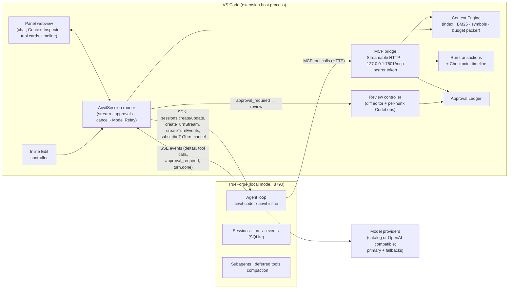
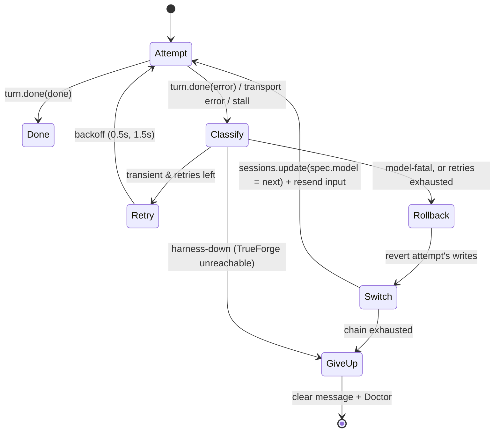

# Anvil — Architecture

## 1. System context



**Eligibility mapping.** The extension is a TrueForge client: it creates sessions and sends turns through
the SDK, and renders streamed events. Every editor capability (read, search, propose a write, run a command)
is an **MCP tool**, so the *agent* decides what to read and change. Models are configured only in TrueForge,
and the extension never calls a provider. The agent definitions live in `agent/*.json`.

## 2. Process and trust boundaries

| Component | Process | Trust notes |
| --- | --- | --- |
| Extension host code | VS Code extension host (Node) | Has full workspace access; all writes funnel through `WorkspaceHost.applyWrite`. |
| Webview | Sandboxed iframe | CSP: no remote scripts, nonce-only script, `postMessage` protocol only; all model text is escaped before rendering. |
| MCP bridge | HTTP server inside the extension host | Binds `127.0.0.1`; `Authorization: Bearer <token>` required (constant-time compare); paths confined to the workspace root. |
| TrueForge | Separate local Node process | Holds model credentials; calls the MCP bridge with the registered header. |

## 3. Main flows

### 3.1 Agent mode (Task B)

```mermaid
sequenceDiagram
  actor U as User
  participant P as Panel
  participant R as AnvilSession
  participant C as Context Engine
  participant T as TrueForge
  participant M as MCP bridge
  participant V as Review

  U->>P: "Add flask config command..."
  P->>R: run(prompt, mentions)
  R->>C: assembleContext(signals, budget)
  C-->>R: ContextPack (items + reasons + tokens)
  R-->>P: Context Inspector card
  R->>T: createTurnStream(prompt + rendered pack)
  T-->>R: model.message.delta … (streamed to panel)
  T->>M: search_code / read_file / find_symbol (read-only, no approval)
  M-->>T: compact results
  T-->>R: tool.approval_required (edit_file cli.py)
  R->>V: open review (simulate edit → hunks)
  U->>V: accept hunk 1, reject hunk 2
  V-->>R: decision (final content) → Ledger.put(key)
  R->>T: subscribeToTurn(after) + createTurnEvents(user.tool_approval allow)
  T->>M: edit_file(args)
  M->>M: Ledger.take(key) → applyWrite(final) → Transaction.record
  M-->>T: "Applied 1/2 hunks; rejected: …"
  Note over T,M: repeats for tests/test_cli.py, docs/cli.rst …
  T-->>R: turn.done(done)
  R-->>P: summary + applied changes (Undo / Revert run)
```

### 3.2 Inline edit (Task A)

1. Command `anvil.inlineEdit` reads the selection, asks for an instruction (input box), and builds an
   inline prompt with the surrounding code, the file path, the language, and a small Context Pack
   (definitions of symbols referenced in the selection).
2. `AnvilSession` (agent `anvil-inline`, its own session) streams the response. The Review controller
   opens a diff (left: a selection snapshot inside the original file; right: a virtual proposed document) and
   **re-renders it on every delta** (throttled to ~10 Hz) using `extractPartialReplacement`.
3. On `turn.done`, `extractReplacement` produces the final text and `computeHunks` builds the hunks. CodeLens
   shows *Accept / Reject* per hunk, and *Accept all / Reject all* at the top.
4. **Scope Lock**: the replacement only ever replaces the selected line range. Accepted hunks are applied
   through `WorkspaceEdit` and saved (native undo works) and recorded in the checkpoint timeline.

### 3.3 Cancellation

`cancel()` → `AbortController.abort()` (stops SSE reading immediately, so the UI unblocks) →
`sessions.cancel(id)` (best effort) → reject pending review promises (reviews close, nothing written) →
kill command child processes → `RunTransaction.rollback()` (when `anvil.cancelBehavior = revert`) → the
panel shows "Cancelled — N files restored". A late MCP write after cancel is refused (`isRunActive()` is false).

### 3.4 Model Relay (Task C)



Stall detection: if no event arrives within `anvil.stallTimeoutSec` (default 45 s) while the turn runs, the
attempt is cancelled and classified as transient.

## 4. Context Engine

* **Index** (`CodeIndex`): walks the workspace (respects `.gitignore` and default excludes, skips binaries and
  files over 512 KB), extracts symbols (regex extractors for Python, TS/JS, Go, Java, Rust, Ruby, C/C++,
  Markdown/RST headings), chunks files at symbol boundaries (fallback: 60-line windows), and indexes chunks
  in an in-memory **BM25** index (identifier-aware tokenizer: camelCase/snake_case splitting, stop-words).
  Updated incrementally from file-system watcher events.
* **Signals** → candidate lists: BM25 chunks for the query; symbol hits for identifiers in the query; path
  matches; open editors, recent edits and the active file; 1-hop import neighbours of the top files.
* **Fusion**: Reciprocal Rank Fusion (`k = 60`) with per-signal weights, and at most 3 chunks per file.
* **Budget packer** (default 12 000 tokens, `chars/4` estimate). Tier order: pins (mentions, selection) ≤ 50%
  → ranked chunks → repo-map skeleton (≈10%, directory tree plus top-level signatures of top-ranked files).
  Each item carries `reason`, `score` and `tokens`. Dropped candidates are listed with the reason
  "over budget".
* **Pull tools** reuse the same index: `search_code`, `find_symbol`, `grep`, `repo_map`, `read_file`
  (windowed). Results are capped so a single tool result never floods the window.

## 5. TrueForge harness features used

| Feature | Use |
| --- | --- |
| Inline agent spec + `sessions.update` | Model Relay switches models inside one session |
| Tool approval (`require_approval_for_tools`) | Drives Anvil's per-hunk review and command approval |
| Deferred tool loading | Anvil server attached with `preload:false`; core tools (`search_code`, `read_file`, `edit_file`, `write_file`) in `preload_tools`; the rest discovered on demand |
| Dynamic subagents | The coder may delegate reconnaissance ("map how CLI commands are registered and tested") to a subagent; only its summary returns; approvals from subagent threads are routed by `thread_id` |
| Compaction | Explicit trigger (60k input tokens) for long multi-turn sessions |
| Sessions view | Every run is inspectable in TrueForge UI; the panel links to `http://localhost:8790/sessions/<id>` |

## 6. Source layout

```
agent/                    TrueForge agent definitions (anvil-coder.json, anvil-inline.json)
config/                   trueforge.example.json (model providers + model chain); local copy is gitignored
scripts/                  setup-trueforge.mjs, demo/setup-flask.sh
src/
  extension.ts            activation + wiring (composition root)
  core/                   PURE TypeScript, no `vscode` import (unit-tested)
    diff/hunks.ts
    edits/applyEdit.ts
    inline/prompt.ts
    context/{tokenize,symbols,chunker,bm25,walker,codeIndex,mentions,assemble}.ts
    agent/{events,toolCalls,fallback}.ts
    ledger.ts  paths.ts  transaction.ts  config.ts
  trueforge/              SDK client, spec builder, setup/registration, AnvilSession runner
  mcp/                    MCP bridge server + tool definitions (depends on WorkspaceHost/WriteGate interfaces)
  host/                   VS Code adapters: workspaceHost, indexService, reviewController, inlineEdit,
                          checkpoints, commandRunner, statusBar, doctor
  panel/                  WebviewViewProvider + protocol.ts (shared host↔webview message types)
webview/                  panel UI (vanilla TS + CSS, bundled by esbuild)
test/unit                 vitest, pure modules
test/integration          vitest: MCP bridge over real HTTP, runner against a mock TrueForge SSE server,
                          retrieval on a Flask-shaped fixture
test/e2e                  real TrueForge (npx) + mock OpenAI-compatible LLM (CI)
test/vscode               @vscode/test-electron smoke suite (activation, commands)
docs/                     project docs + docs/src/** per-file mirror
openspec/                 specs and change proposals
```

Dependency rule: `core` ← `trueforge`, `mcp` ← `host`, `panel` ← `extension.ts`. `core` never imports
`vscode`, and `mcp` reaches VS Code only through the `WorkspaceHost` and `WriteGate` interfaces.

## 7. Module contracts (authoritative — implementers must match these signatures)

```ts
// ---------- core/diff/hunks.ts ----------
export interface Hunk { id: number; origStart: number; origLines: string[]; newStart: number; newLines: string[] }
// origStart/newStart: 0-based line indices. Hunks contain only changed lines (no context lines).
// Line endings: untouched/rejected lines keep their own terminators; inserted lines use the original's dominant EOL.
// A trailing-newline or dominant-EOL change alone is one hunk over the last line (`eofOnly: true`). With zero hunks
// the review reports "No visible changes." and applies `proposed` only if it differs from the original (never "rejected").
export type HunkDecision = 'pending' | 'accepted' | 'rejected';
export function splitLines(text: string): { lines: string[]; eol: '\n' | '\r\n'; trailingNewline: boolean };
export function computeHunks(original: string, proposed: string): Hunk[];
export function applyHunks(original: string, hunks: Hunk[], accepted: ReadonlySet<number>): string;
export function previewContent(original: string, hunks: Hunk[], decisions: ReadonlyMap<number, HunkDecision>): string; // pending+accepted applied
export function summarizeHunk(h: Hunk, maxLines?: number): string; // unified-diff style text for agent feedback

// ---------- core/edits/applyEdit.ts ----------
export type EditOp =
  | { kind: 'write'; path: string; content: string }
  | { kind: 'replace'; path: string; oldString: string; newString: string; replaceAll?: boolean };
export type EditErrorCode = 'FILE_NOT_FOUND' | 'NOT_FOUND' | 'AMBIGUOUS' | 'NO_CHANGE' | 'INVALID';
export class EditError extends Error { constructor(public code: EditErrorCode, message: string) }
// exact match first; then a whitespace-tolerant line match (trimmed lines) if it is unique.
export function simulateEdit(current: string | null, op: EditOp): string;

// ---------- core/ledger.ts ----------
export function stableStringify(value: unknown): string;
export function canonicalKey(tool: string, args: unknown): string; // sha256 hex of `${tool}\n${stableStringify(args)}`
export interface LedgerEntry { finalContent: string | null; acceptedHunks: number[]; totalHunks: number; feedback: string }
export class ApprovalLedger { put(key: string, e: LedgerEntry): void; take(key: string): LedgerEntry | undefined; clear(): void; size(): number }

// ---------- core/paths.ts ----------
export class PathError extends Error {}
export function resolveInWorkspace(root: string, p: string): string; // absolute; throws PathError on escape/absolute-outside/NUL
export function toRelative(root: string, abs: string): string;       // POSIX separators

// ---------- core/transaction.ts ----------
export interface FileStore { read(rel: string): Promise<string | null>; write(rel: string, content: string): Promise<void>; remove(rel: string): Promise<void> }
export interface AppliedChange { seq: number; runId: string; path: string; before: string | null; after: string; at: number; summary: string }
export interface RestoreReport { restored: string[]; conflicts: string[] }
export class CheckpointStore {
  constructor(store: FileStore, maxEntries?: number);
  record(c: Omit<AppliedChange, 'seq' | 'at'>): AppliedChange;
  list(): AppliedChange[];
  forRun(runId: string): AppliedChange[];
  undo(seq: number, opts?: { force?: boolean }): Promise<RestoreReport>;      // restores `before` if current === after
  revertRun(runId: string, opts?: { force?: boolean }): Promise<RestoreReport>; // reverse order, earliest `before` per file
  onChange(listener: () => void): () => void;
}

// ---------- core/inline/prompt.ts ----------
export interface InlineRequest { path: string; languageId: string; before: string; selection: string; after: string; instruction: string; context?: string }
export function buildInlinePrompt(r: InlineRequest): string;
export function extractReplacement(text: string): string;           // last complete fenced block, else whole text trimmed of fences
export function extractPartialReplacement(text: string): string;    // streaming-safe (inside an unterminated fence)
export function matchIndentation(replacement: string, selection: string): string;

// ---------- core/context/* ----------
export interface SymbolInfo { name: string; kind: 'class' | 'function' | 'method' | 'variable' | 'interface' | 'type' | 'heading' | 'module'; path: string; line: number; endLine: number; container?: string; signature: string }
export interface Chunk { id: string; path: string; startLine: number; endLine: number; text: string; symbol?: string }
export interface SearchHit { chunk: Chunk; score: number; matched: string[] }
export function tokenize(text: string): string[];
export function extractSymbols(path: string, content: string): SymbolInfo[];
export function chunkFile(path: string, content: string, symbols: SymbolInfo[]): Chunk[];
export class Bm25Index { add(id: string, tokens: string[]): void; remove(id: string): void; search(q: string[], k: number): { id: string; score: number; matched: string[] }[]; size(): number }
export function walkWorkspace(root: string, opts?: { maxFileBytes?: number; extraIgnores?: string[] }): Promise<string[]>;
export class CodeIndex {
  constructor(root: string);
  build(onProgress?: (done: number, total: number) => void): Promise<void>;
  updateFile(rel: string, content: string): void;
  removeFile(rel: string): void;
  files(): string[];
  getContent(rel: string): string | undefined;
  symbolsOf(rel: string): SymbolInfo[];
  search(query: string, k?: number): SearchHit[];
  findSymbol(name: string, kind?: string): SymbolInfo[];
  grep(pattern: string, opts?: { glob?: string; limit?: number; ignoreCase?: boolean }): { path: string; line: number; text: string }[];
  neighbors(rel: string): string[];                                  // 1-hop import graph (both directions)
  repoMap(opts?: { maxTokens?: number; focus?: string[] }): string;
}
export interface Mention { kind: 'file' | 'symbol'; value: string; raw: string }
export function parseMentions(text: string, knownFiles: ReadonlySet<string>): { mentions: Mention[]; cleaned: string };
export interface ContextSignals { query: string; mentions: Mention[]; activeFile?: string; selection?: { path: string; startLine: number; endLine: number; text: string }; openFiles: string[]; recentFiles: string[] }
export interface ContextItem { path: string; startLine?: number; endLine?: number; kind: 'pinned' | 'selection' | 'symbol' | 'chunk' | 'repo-map'; reason: string; score: number; tokens: number; text: string }
export interface ContextPack { items: ContextItem[]; budget: number; used: number; dropped: { path: string; reason: string }[] }
export function estimateTokens(text: string): number;               // Math.ceil(chars / 4)
export function assembleContext(index: CodeIndex, s: ContextSignals, budget: number): ContextPack;
export function renderContextPack(p: ContextPack): string;           // <anvil_context …> block placed in the user message

// ---------- core/agent/toolCalls.ts ----------
export interface RawToolCall { id: string; function: { name: string; arguments: string }; toolInfo?: { type: string; name: string; serverName?: string } }
export interface ResolvedToolCall { callId: string; threadId: string; server?: string; tool: string; input: Record<string, unknown> }
export function resolveToolCall(call: RawToolCall, threadId: string): ResolvedToolCall; // unwraps deferred call_tool {mcp_server, tool_name, input}

// ---------- core/agent/events.ts ----------
export type ToolStatus = 'streaming' | 'awaiting-approval' | 'running' | 'done' | 'denied' | 'error';
export interface ToolCallView { id: string; threadId: string; tool: string; server?: string; input: Record<string, unknown>; status: ToolStatus; result?: string }
export interface MessageView { id: string; threadId: string; content: string }
export interface ThreadView { id: string; title: string; status: 'running' | 'done' | 'error' }
export interface TurnView { turnId?: string; status: 'running' | 'paused' | 'done' | 'cancelled' | 'error'; messages: MessageView[]; toolCalls: ToolCallView[]; threads: ThreadView[]; pending: ResolvedToolCall[]; error?: string; output?: string; lastEventId?: string; metrics?: Record<string, number> }
export class TurnReducer { apply(event: unknown): void; view(): TurnView; toolCall(id: string): ResolvedToolCall | undefined; reset(): void }

// ---------- core/agent/fallback.ts ----------
export type FailureKind = 'transient' | 'model-fatal' | 'harness-down' | 'cancelled' | 'unknown';
export function classifyFailure(f: { message?: string; statusCode?: number; code?: string; phase: 'connect' | 'turn' | 'stall' }): FailureKind;
export interface RelayPolicy { models: string[]; retriesPerModel: number; backoffMs: number[] }
export type RelayStep = { action: 'retry'; model: string; delayMs: number } | { action: 'switch'; model: string; from: string } | { action: 'give-up'; reason: string };
export class ModelRelay { constructor(p: RelayPolicy); current(): string; onFailure(kind: FailureKind, message: string): RelayStep; reset(): void }

// ---------- core/config.ts ----------
export interface AnvilConfig { trueforgeUrl: string; models: string[]; retriesPerModel: number; stallTimeoutSec: number; contextBudget: number; mcpPort: number; cancelBehavior: 'revert' | 'keep'; commandTimeoutSec: number }
export const DEFAULT_CONFIG: AnvilConfig;

// ---------- mcp/server.ts ----------
export interface DiagnosticInfo { path: string; line: number; severity: 'error' | 'warning' | 'info'; message: string }
export interface WorkspaceHost {
  readonly root: string;
  readonly index: CodeIndex;
  readFile(rel: string): Promise<string | null>;
  listFiles(dir?: string, glob?: string, limit?: number): Promise<string[]>;
  diagnostics(rel?: string): Promise<DiagnosticInfo[]>;
  applyWrite(rel: string, content: string, summary: string): Promise<void>;   // records into the active run transaction
  runCommand(command: string, opts: { cwd?: string; timeoutMs: number }): Promise<{ exitCode: number | null; output: string; timedOut: boolean }>;
}
export interface WriteGate {
  isRunActive(): boolean;
  // returns final content to write (null = rejected) plus feedback for the agent. Uses the ledger; falls back to an interactive review.
  resolveWrite(tool: 'edit_file' | 'write_file', args: Record<string, unknown>, current: string | null, proposed: string): Promise<{ content: string | null; feedback: string }>;
  authorizeCommand(args: Record<string, unknown>): Promise<boolean>;
}
export function createAnvilMcpServer(host: WorkspaceHost, gate: WriteGate): McpServer; // registers tools
export function startBridge(opts: { host: WorkspaceHost; gate: WriteGate; port: number; token: string; bind?: string }): Promise<{ url: string; port: number; close(): Promise<void> }>;

// ---------- trueforge/session.ts ----------
export interface ApprovalRequest { call: ResolvedToolCall }
export type ApprovalDecision = { allow: true } | { allow: false; reason: string };
export interface RunHooks {
  onEvent?(event: unknown, view: TurnView): void;
  onApproval(req: ApprovalRequest): Promise<ApprovalDecision>;
  onQuestion?(question: string, options: string[]): Promise<string>;
  onModelSwitch?(from: string, to: string, reason: string): void;
  onRetry?(model: string, attempt: number, delayMs: number, reason: string): void;
  beforeRetry?(): Promise<void>;                                        // host rolls back the failed attempt's writes
}
export interface RunResult { status: 'done' | 'cancelled' | 'error'; output?: string; model: string; error?: string; sessionId?: string; metrics?: Record<string, number> }
export class AnvilSession {
  constructor(opts: { client: TrueForge; agent: AgentDefinition; relay: ModelRelay; stallTimeoutMs: number; title?: string; baseUrl?: string;
    isBusy?: () => boolean /* stall watchdog re-arms while true (host mid tool call) */ });
  readonly sessionId: string | undefined;
  run(input: string, hooks: RunHooks): Promise<RunResult>;
  cancel(): Promise<void>;
  dispose(): void;
}
```

## 8. Host ↔ webview protocol (`src/panel/protocol.ts`)

```ts
export type HostToWebview =
  | { type: 'init'; models: string[]; activeModel: string; trueforgeUrl: string }
  | { type: 'health'; trueforge: 'ok' | 'down' | 'unknown'; bridge: 'ok' | 'down'; indexedFiles: number }
  | { type: 'runStarted'; runId: string; prompt: string }
  | { type: 'context'; runId: string; items: { path: string; startLine?: number; endLine?: number; kind: string; reason: string; tokens: number }[]; budget: number; used: number; dropped: number }
  | { type: 'text'; runId: string; messageId: string; threadId: string; content: string }   // full content so far (idempotent)
  | { type: 'tool'; runId: string; call: { id: string; threadId: string; tool: string; summary: string; status: string; result?: string } }
  | { type: 'thread'; runId: string; thread: { id: string; title: string; status: string } }
  | { type: 'approval'; runId: string; id: string; kind: 'edit' | 'command'; title: string; detail: string }
  | { type: 'approvalResolved'; runId: string; id: string; outcome: string }
  | { type: 'modelSwitch'; runId: string; from: string; to: string; reason: string }
  | { type: 'notice'; runId?: string; level: 'info' | 'warn' | 'error'; message: string; actions?: string[] }
  | { type: 'runFinished'; runId: string; status: 'done' | 'cancelled' | 'error'; model: string; error?: string; sessionId?: string; metrics?: Record<string, number> }
  | { type: 'changes'; changes: { seq: number; runId: string; path: string; summary: string; at: number }[] }
  | { type: 'mentionResults'; query: string; items: { kind: 'file' | 'symbol'; label: string; detail: string; insert: string }[] };

export type WebviewToHost =
  | { type: 'ready' }
  | { type: 'send'; text: string }
  | { type: 'cancel' }
  | { type: 'newChat' }
  | { type: 'approve'; id: string; allow: boolean; reason?: string }
  | { type: 'mentionQuery'; query: string }
  | { type: 'openFile'; path: string; line?: number }
  | { type: 'openSession' }
  | { type: 'undoChange'; seq: number }
  | { type: 'revertRun'; runId: string }
  | { type: 'doctor' }
  | { type: 'notice-action'; action: string };
```

## 9. Configuration surface (VS Code settings, prefix `anvil.`)

| Setting | Default | Purpose |
| --- | --- | --- |
| `trueforgeUrl` | `http://localhost:8790` | TrueForge base URL |
| `models` | `[]` (must be set; Doctor warns) | Ordered model chain (`provider/model` FQNs configured in TrueForge) |
| `retriesPerModel` | `1` | Transient retries before switching |
| `stallTimeoutSec` | `45` | No-event timeout → transient failure |
| `contextBudget` | `12000` | Push-context token budget |
| `mcpPort` | `7801` | MCP bridge port (127.0.0.1) |
| `cancelBehavior` | `revert` | `revert` rolls back a cancelled run's applied changes; `keep` keeps accepted ones |
| `commandTimeoutSec` | `120` | `run_command` timeout |
