# Anvil — Implementation Plan

Owner / PM / reviewer: **Claude Opus** (head of staff). Implementers: **Sonnet** and **Haiku** subagents, each in its
own git worktree and branch, merged through GitHub PRs (`gh pr create` / `gh pr merge`).
Spec: `openspec/changes/add-anvil-v1`. Contracts: `docs/ARCHITECTURE.md` §7–§8. Decisions: `docs/DECISIONS.md`.
Progress log: `docs/LOG.md`.

## 0. Ground rules for every subagent

1. Work only in your worktree and branch. Never touch `main`. Make small **modular commits** (one logical unit each,
   Conventional Commits: `feat(core): …`, `test(context): …`). Commits are unsigned (`git -c commit.gpgsign=false`).
2. Implement **exactly** the signatures in ARCHITECTURE §7/§8. If a contract is wrong, stop and report; do not
   invent a different API.
3. `src/core/**` must not import `vscode`. Keep functions short (aim for ≤ 40 lines) with no clever abstractions, and
   prefer plain data and pure functions.
4. Do not add dependencies. All dependencies are installed by Phase 1. If one is truly missing, report it.
5. Every module ships with tests. `npm run typecheck && npm run lint && npm test` must pass before you finish.
6. Finish by reporting: branch name, commits, test results, and any deviations.

## 1. Phases

| Phase | Goal | Who | Branch(es) | Exit criteria |
| --- | --- | --- | --- | --- |
| 0 Study and plan | Problem analysis, TrueForge research, idea, architecture, decisions, specs | Opus | `main` | docs committed, openspec change valid |
| 1 Scaffold | Package, toolchain, contract stubs, agent definitions, example config | Sonnet ×1 | `feat/scaffold` | build, lint, typecheck and one test green; PR merged |
| 2 Parallel core | Implement the independent modules against the contracts | Sonnet ×4, Haiku ×1 | `feat/core-safety`, `feat/context-engine`, `feat/trueforge-runner`, `feat/mcp-bridge`, `feat/webview-panel`, `ci/workflows` | each PR green and reviewed by Opus, then merged |
| 3 Integration | VS Code host adapters, review UI, inline edit, wiring, commands, settings | Sonnet ×1 (+ ×1 for review/inline) | `feat/host-integration` | extension activates; smoke suite green |
| 4 Verification | Real-TrueForge e2e (mock LLM), Flask retrieval check, integration suite | Gemini via Antigravity (`gemini-integration-tester`) | `test/e2e-trueforge` | CI phase 2 green |
| 5 Documentation | Per-file docs mirror `docs/src/**`, CODEBASE, AGENTS, CONTRIBUTING, FLOW, README | `opencode-docs` (Ollama gemma4:12b) + Haiku for README | `docs/*` | docs PR merged |
| 6 Review and hardening | Independent review → GitHub issues → fixes one by one | `gemini-reviewer` + `code-reviewer` → Sonnet fixers | `fix/<issue>` | all issues closed |
| 7 Release | Tag `v0.1.0`, `.vsix` from the build workflow, write-up draft | Opus | `main` | release published with the vsix |

```mermaid
gantt
  dateFormat X
  axisFormat %s
  section Plan
  Phase 0 study+plan        :done, p0, 0, 1
  section Build
  Phase 1 scaffold          :p1, after p0, 1
  core-safety               :p2a, after p1, 2
  context-engine            :p2b, after p1, 2
  trueforge-runner          :p2c, after p1, 2
  mcp-bridge                :p2d, after p1, 2
  webview-panel             :p2e, after p1, 2
  ci workflows              :p2f, after p1, 1
  Phase 3 integration       :p3, after p2a, 2
  section Verify
  Phase 4 e2e               :p4, after p3, 1
  Phase 5 docs              :p5, after p3, 1
  Phase 6 review/issues     :p6, after p4, 2
  Phase 7 release           :p7, after p6, 1
```



## 2. Phase 1 — Scaffold (`feat/scaffold`, Sonnet)

* `package.json`: name `anvil`, displayName "Anvil — TrueForge Coding Agent", publisher `anvil-dev`, engines
  `vscode ^1.95.0`, `main: ./dist/extension.js`, MIT. Scripts: `build`, `watch`, `typecheck`, `lint`, `format`,
  `format:check`, `test` (vitest unit + integration), `test:unit`, `test:integration`, `test:e2e`, `test:vscode`,
  `package` (vsce), `setup:trueforge`.
* Dependencies: `@truefoundry/trueforge-sdk@0.185.0`, `@modelcontextprotocol/sdk`, `zod`, `diff`, `ignore`,
  `picomatch`. Dev dependencies: `typescript`, `esbuild`, `vitest`, `eslint` + `typescript-eslint`, `prettier`,
  `@types/vscode@1.95`, `@types/node@20`, `@types/diff`, `@types/picomatch`, `@vscode/test-electron`, `@vscode/vsce`,
  `mocha`, `@types/mocha`.
* `tsconfig.json` (strict, ES2022, module NodeNext or Bundler, `noUncheckedIndexedAccess`), `esbuild.mjs`
  (two bundles: extension CJS with `vscode` external, webview IIFE), `eslint.config.mjs` (flat config, typescript-eslint
  recommended plus a `no-restricted-imports` ban on `vscode` inside `src/core`), `.prettierrc`, `vitest.config.ts`,
  `.vscodeignore`, `.editorconfig`, `.nvmrc` (22).
* Contract stubs for **every** module in ARCHITECTURE §7 plus `src/panel/protocol.ts` (§8): exact exports, with
  bodies that throw `new Error('not implemented')` (types and interfaces complete). `src/extension.ts` with an
  `activate` that logs "Anvil activated".
* `agent/anvil-coder.json`, `agent/anvil-inline.json` (Appendix A), `config/trueforge.example.json` (Appendix B).
* `package.json` `contributes`: view container `anvil` (activity bar) with webview view `anvil.panel`; commands
  `anvil.inlineEdit`, `anvil.cancel`, `anvil.newChat`, `anvil.setup`, `anvil.doctor`, `anvil.undoLast`,
  `anvil.review.acceptHunk`, `anvil.review.rejectHunk`, `anvil.review.acceptAll`, `anvil.review.rejectAll`,
  `anvil.openSession`; keybindings `ctrl+alt+e` / `cmd+alt+e` (inline edit, `editorTextFocus`), `escape` → `anvil.cancel`
  when `anvil.running`; configuration properties per ARCHITECTURE §9.
* `test/unit/smoke.test.ts` (imports `DEFAULT_CONFIG`).

## 3. Phase 2 — parallel workstreams

### 2A `feat/core-safety` (Sonnet)
Files: `src/core/diff/hunks.ts`, `src/core/edits/applyEdit.ts`, `src/core/ledger.ts`, `src/core/paths.ts`,
`src/core/transaction.ts`, `src/core/inline/prompt.ts`, `src/core/config.ts`. Tests in `test/unit/`.
Key behaviours: CRLF and trailing-newline preservation; hunks from `diff.diffLines`; `applyHunks` with any subset;
`simulateEdit` exact, then trimmed-line unique match, with error codes; canonical keys stable under key reordering;
path escapes (`..`, absolute outside root, NUL, symlink-free normalisation); CheckpointStore undo, revert-run and
conflicts; inline prompt with fenced output instruction; partial and complete fence extraction; indentation matching.

### 2B `feat/context-engine` (Sonnet)
Files: `src/core/context/{tokenize,symbols,chunker,bm25,walker,codeIndex,mentions,assemble}.ts`. Tests plus fixture
`test/fixtures/mini-flask/` (a trimmed Flask-shaped repo: `src/flask/{cli,helpers,app,config}.py`,
`tests/test_cli.py`, `docs/cli.rst`, `docs/config.rst`, a `.gitignore`). The integration test asserts that Task-B-style
queries rank `cli.py`, `test_cli.py` and `cli.rst` in the top 5 files, and Task-A queries rank `helpers.py` first.
Budget never exceeded. Repo map respects `maxTokens`. Index build of 1k files under 2 s.

### 2C `feat/trueforge-runner` (Sonnet)
Files: `src/core/agent/{events,toolCalls,fallback}.ts`, `src/trueforge/{client,spec,setup,session}.ts`.
Mock server: `test/helpers/mockTrueForge.ts`, a node `http` server implementing `POST /api/v1/sessions`,
`PATCH /api/v1/sessions/:id`, `POST /api/v1/sessions/:id/turns` (SSE), `GET …/turns/:tid/events/stream` or the SDK's
actual subscribe path, `POST …/turns/:tid/events`, and `POST /api/v1/sessions/:id/cancel`, driven by scripted
scenarios. **Verify the exact paths and wire format from the SDK sources in `node_modules/@truefoundry/trueforge-sdk`**.
Integration tests: streaming, approval pause and resume (allow/deny), cancel mid-stream, fallback on a 401-style
`turn.done{error}`, retry on 503, stall timeout, harness-down classification, and subagent thread routing.

### 2D `feat/mcp-bridge` (Sonnet)
Files: `src/mcp/{server,tools,auth}.ts`. Tools as in the mcp-bridge spec, with zod input schemas, annotations
(`readOnlyHint` / `destructiveHint`), and compact text results. The bridge uses `node:http` + `StreamableHTTPServerTransport`
in stateless mode (new server and transport per request), bearer auth with `timingSafeEqual`, Origin check, and a
1 MB body limit. Integration tests use the MCP SDK `Client` + `StreamableHTTPClientTransport` against a real port, with
fake `WorkspaceHost`/`WriteGate`: tool listing, auth rejection, path traversal, the edit flow through the gate
(approve, partial, reject), write refused when no run is active, command timeout and output cap.

### 2E `feat/webview-panel` (Sonnet)
Files: `webview/{main.ts,render.ts,markdown.ts,styles.css}`, `src/panel/panelProvider.ts`. UI: header (model chip,
health dot, Open in TrueForge, New chat, Doctor), transcript (user bubble, Context Inspector card with budget bar,
streaming markdown, tool cards, thread groups, approval cards with Allow/Deny, model-switch notices, run footer with
metrics), applied-changes timeline (Undo / Revert run), composer (textarea, `@` autocomplete via `mentionQuery`,
Send / Stop). VS Code theme variables only. CSP with nonce. Unit tests for `markdown.ts` (XSS escaping) and the
render reducers using jsdom-free string rendering.

### 2F `ci/workflows` (Haiku)
`.github/workflows/ci.yml` (phase 1 `quality`, phase 2 `integration` with `needs: quality`, final `ci-ok`; triggers
`push: branches: ['**']` and `pull_request: branches: ['**']`; Node 22; npm cache; xvfb for `test:vscode`; the e2e step
runs when `test/e2e` exists). `.github/workflows/build.yml` (vsce package, upload artifact, release on `v*` tags).
`scripts/setup-trueforge.mjs` (reads `config/trueforge.local.json`, expands `${ENV}` values, PUTs providers, MCP
server and agents via the SDK). `scripts/demo/setup-flask.sh` (clone pallets/flask, check out 3.1.3, venv,
`pip install -e . pytest`). `.github/dependabot.yml`, PR template, issue templates.

## 4. Phase 3 — Integration (`feat/host-integration`, Sonnet)
Files: `src/host/{workspaceHost,indexService,reviewController,inlineEdit,checkpoints,commandRunner,statusBar,doctor,runController}.ts`,
`src/extension.ts`, plus the `contributes` wiring.
* `indexService`: builds `CodeIndex` on activation (progress in the status bar) and updates it from `FileSystemWatcher`.
* `reviewController`: TextDocumentContentProviders (`anvil-original`, `anvil-proposed`), CodeLens per hunk,
  accept/reject commands, a decisions queue (one review at a time), and a `review(change, {live?})` API returning
  `Promise<{content|null, accepted, total, feedback}>`; the live-update API is used by inline edit.
* `runController`: owns the `AnvilSession` per chat, the ApprovalLedger, the CheckpointStore and the active run id.
  It implements `RunHooks` (edits → review → ledger; commands → panel approval card), `WriteGate` and cancel.
* `inlineEdit`: the command flow from ARCHITECTURE §3.2.
* `doctor`: health checks with an output-channel report. `statusBar`: active model, run state, index status.
* `extension.ts`: composition root. Token in SecretStorage → start the bridge → auto-setup when TrueForge is reachable.
* `test/vscode/`: activation and command-registration smoke tests (`@vscode/test-electron`).

## 5. Phase 4 — Verification (`test/e2e-trueforge`, Gemini via Antigravity CLI)
* `test/e2e/mockLlm.ts`: an OpenAI-compatible `/v1/chat/completions` server (streaming SSE) with scripted turns
  (tool call `search_code`, then `edit_file`, then a final message).
* `test/e2e/trueforge.e2e.test.ts`: spawn `npx -y @truefoundry/trueforge@latest --port <p>` with a temp
  `SQLITE_PATH`, wait for `/healthz`, register provider, bridge and agent, run `AnvilSession` with fake hooks, and assert
  the tool loop, the approval-driven write, cancel and fallback (`[broken/x, mock/y]`).
* Run the full suite and report.

## 6. Phase 5 — Documentation
* `opencode-docs` writes `docs/src/<path>.md` for every source file (purpose, exports, collaborators, invariants),
  plus Mermaid flows in `docs/FLOW.md`.
* Opus or Haiku write `docs/CODEBASE.md`, `docs/AGENTS.md` (guide for AI agents working on the repo),
  `CONTRIBUTING.md`, `README.md` (setup from a clean clone, starting TrueForge, loading the agent definitions, the model
  config example, fork point "from scratch", architecture summary, demo tasks), and `docs/WRITEUP.md` (the 8 required
  headings, with placeholders only for team details and video timestamps).

## 7. Phase 6 — Review and issues
`gemini-reviewer` and `code-reviewer` review the whole codebase against the spec and the problem statement. Opus
triages the findings into GitHub issues (`bug`, `enhancement`, `security` labels). Each issue gets a fixer subagent
on `fix/<n>-<slug>`, a PR that references `Fixes #n`, Opus reviews, and the PR is merged once CI is green.

## 8. Risk register

| Risk | Mitigation |
| --- | --- |
| SDK wire details differ from the docs | Mock server built from the SDK sources; real-TrueForge e2e in CI |
| TrueForge cannot reach the bridge (port in use) | Configurable port; Doctor checks the round trip; setup re-registers the URL |
| Weak model never calls tools | Push Context Pack; inline edit needs no tools; search/replace edits |
| Ledger key mismatch (args re-serialised differently) | `stableStringify` canonicalisation; fallback to an interactive review in the MCP handler |
| Running TrueForge locally blocked in the dev session | e2e runs in CI only |
| Merge conflicts across parallel branches | All deps and contract stubs land in Phase 1; each stream owns disjoint files |

---

## Appendix A — Agent definitions

`agent/anvil-coder.json` (`model.name` is a placeholder, replaced at runtime by the Model Relay):

```json
{
  "name": "anvil-coder",
  "description": "Anvil agent mode: plans and makes multi-file code changes in the user's VS Code workspace through the anvil-editor MCP tools.",
  "manifest": {
    "model": { "name": "PLACEHOLDER/model", "params": { "temperature": 0.2 } },
    "instructions": "<see below>",
    "mcp_servers": [
      {
        "name": "anvil-editor",
        "enable_tools": ["@all"],
        "preload": false,
        "preload_tools": ["search_code", "read_file", "edit_file", "write_file"],
        "require_approval_for_tools": ["edit_file", "write_file", "run_command"]
      }
    ],
    "config": {
      "dynamic_sub_agents": { "enabled": true },
      "ask_user_questions": { "enabled": true },
      "generative_ui": { "enabled": false },
      "context_management": { "compaction": { "enabled": true, "trigger": { "type": "input_tokens", "value": 60000 } } },
      "iteration_limit": 60
    }
  }
}
```

Instructions (anvil-coder):

```
You are Anvil, a senior software engineer working inside the user's VS Code workspace through the `anvil-editor` tools.
The user message contains an <anvil_context> block: files and snippets Anvil pre-selected for this request, each with
the reason it was chosen. Treat it as a starting point, not the whole truth.

Workflow:
1. Start your reply with a short "Context plan": the files you will inspect or change and why (one line each).
2. Explore before editing: use search_code / find_symbol / grep / read_file to confirm where things live and how
   similar features are implemented, tested and documented. For broad reconnaissance in a large repository you may
   delegate to a subagent and ask it for a concise summary of the relevant files and conventions.
3. Make the change with edit_file (exact old_string → new_string; old_string must match the file exactly once and
   include enough surrounding lines to be unique). Use write_file only for new files. Follow the project's existing
   style, and update tests and documentation when the request implies them.
4. Every edit is reviewed hunk by hunk by the user. If a tool result says hunks were rejected, respect that decision
   and do not re-apply them unless asked.
5. Optionally verify with run_command (e.g. the relevant test file); the user approves each command.
6. Finish with a brief summary: files changed and how to verify.

Rules: never invent files, symbols or APIs you have not seen; read before you edit. Keep edits minimal and focused on
the request. Do not touch unrelated code.
```

`agent/anvil-inline.json`:

```json
{
  "name": "anvil-inline",
  "description": "Anvil inline edit: rewrites a selected code region according to an instruction and returns only the replacement code.",
  "manifest": {
    "model": { "name": "PLACEHOLDER/model", "params": { "temperature": 0 } },
    "instructions": "You rewrite a selected region of code according to the user's instruction. Reply with exactly one fenced code block containing the full replacement for the selected region, and nothing else: no explanations, no surrounding code outside the selection. Preserve the original indentation, style and any code in the selection that the instruction does not ask you to change. If the instruction asks to update a docstring or comments inside the selection, do so.",
    "mcp_servers": [],
    "config": {
      "dynamic_sub_agents": { "enabled": false },
      "ask_user_questions": { "enabled": false },
      "generative_ui": { "enabled": false },
      "iteration_limit": 2
    }
  }
}
```

## Appendix B — `config/trueforge.example.json`

```json
{
  "trueforgeUrl": "http://localhost:8790",
  "modelProviders": [
    {
      "type": "custom",
      "name": "groq",
      "base_url": "https://api.groq.com/openai/v1",
      "auth": { "api_key": "${GROQ_API_KEY}" },
      "models": [{ "model_id": "llama-3.3-70b-versatile", "name": "llama-3-3-70b", "properties": { "context_length": 131072, "max_output_tokens": 8192 } }]
    },
    {
      "type": "custom",
      "name": "ollama",
      "base_url": "http://localhost:11434/v1",
      "models": [{ "model_id": "qwen2.5-coder:14b", "name": "qwen2-5-coder-14b", "properties": { "context_length": 32768 } }]
    }
  ],
  "models": ["groq/llama-3-3-70b", "ollama/qwen2-5-coder-14b"]
}
```
